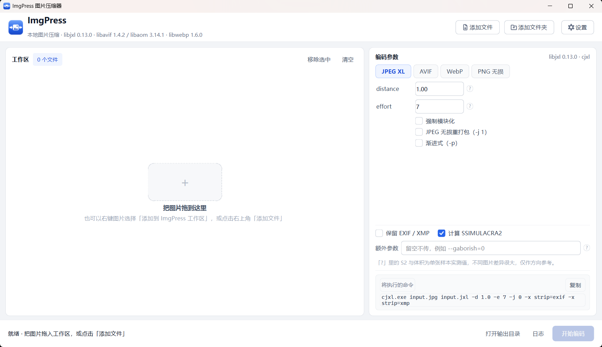

# ImgPress

**An image compressor for Windows** — supports four compression algorithms (JPEG XL / AVIF / WebP / lossless PNG).

Every parameter is adjustable; compare the algorithms side by side and find the one that fits your images best.

English · [中文](README.md)



   

   ## What it does

- **Four algorithms**: JPEG XL (VarDCT or modular), AVIF, WebP (lossy and lossless), plus oxipng for lossless PNG.
- **Comparable by design**: all four codecs report the same metrics (size, ratio, bpp, S2), so you can compare and pick on evidence rather than vibes.
- **Every parameter on screen**: distance, effort, tune, bit depth, chroma subsampling, preset, sns, filter, zopfli… with field notes behind the `?`.
- **Live command preview**: the exact command line is shown and copyable, so GUI and CLI stay in sync.
- **Quality measured**: optional SSIMULACRA2 scoring per image.
- **Side-by-side preview**: original vs. result, synced zoom and pan, 1:1 inspection.
- **Shell integration**: register a context-menu entry (HKCU, no admin) and add images — including multi-selections — straight to the workspace.
- **Fully offline**: nothing is uploaded; the encoders are local executables.
- **Bilingual UI**: 简体中文 / English, following the system locale or set manually.

## Install

Requires Windows 10/11 and Python 3.10+.

```bat
git clone https://github.com/syj150/ImgPress.git
cd ImgPress
python scripts\bootstrap.py --build
.venv\Scripts\python main.py
```

`bootstrap.py` creates `.venv`, installs PySide6 (plus PyInstaller with `--build`), downloads the
four encoder binaries from their official releases into `tools\bin`, then runs `--version` on each.
It is idempotent — re-run it whenever something failed halfway.

Useful flags: `--skip-tools` (Python deps only), `--force` (re-download encoders), `--no-venv`.

## Usage

Drop images in, pick an encoder tab, adjust parameters, press Start. Output goes next to the source
file with a new extension; the original is always kept. Double-click a row for the comparison view.

To pick a strategy: run the same batch through each of the four codecs. `bpp` and `S2` use the same
definition everywhere, so the numbers are directly comparable. Switching tabs keeps the previous
run's results on screen until you press Start again.

Right-click integration: Settings → Context menu → Register (writes `HKEY_CURRENT_USER`, covers
`.jpg .jpeg .jfif .png .webp .bmp .tif .tiff .gif .avif .jxl`).

Windows 11 hides these entries under "Show more options" (Shift+F10). If you'd rather have the
Windows 10 style menu back, this restores it system-wide (fully reversible):

```bat
:: restore the classic context menu
reg add "HKCU\Software\Classes\CLSID\{86ca1aa0-34aa-4e8b-a509-50c905bae2a2}\InprocServer32" /f /ve
taskkill /f /im explorer.exe & start explorer.exe

:: to undo, run these two lines instead
:: reg delete "HKCU\Software\Classes\CLSID\{86ca1aa0-34aa-4e8b-a509-50c905bae2a2}" /f
:: taskkill /f /im explorer.exe & start explorer.exe
```

```
ImgPress.exe --add "a.jpg" "b.png"   add files and open the window
ImgPress.exe --install-menu           register the context menu
ImgPress.exe --uninstall-menu         remove it
ImgPress.exe --diagnose               print environment info (attach to bug reports)
```

## A note on the numbers

The percentages and S2 values quoted in the README and in the app's `?` tooltips come from a small
set of test images. Results shift noticeably with different content — high-frequency detail,
gradients and colored line art especially. Treat them as direction, not constants.

## License

MIT © 2026 [syj150](https://github.com/syj150). Use it, fork it, ship it — keep the copyright notice.

## Credits

Encoding by [libjxl](https://github.com/libjxl/libjxl), [libavif](https://github.com/AOMediaCodec/libavif)
([libaom](https://aomedia.googlesource.com/aom)), [libwebp](https://chromium.googlesource.com/webm/libwebp)
and [oxipng](https://github.com/shssoichiro/oxipng). UI built with
[Qt for Python](https://doc.qt.io/qtforpython/).
