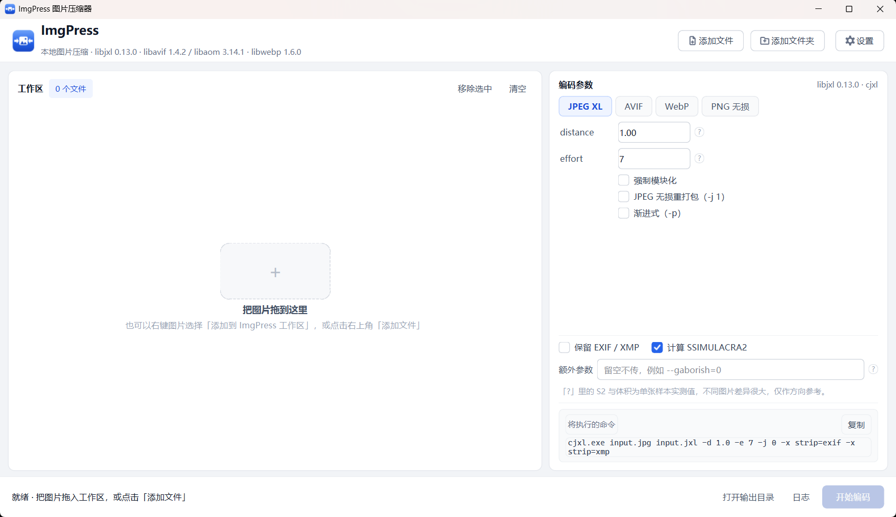

# ImgPress

**Windows 上的图片压缩器** —— 支持四种压缩算法（JPEG XL / AVIF / WebP / PNG 无损优化）。

全部参数可调，通过多算法对比找到最适合你的压缩算法。

[English](README.en.md) · 中文



   

| 组件      | 版本                                       |
| ------- | ---------------------------------------- |
| libjxl  | 0.13.0（cjxl / djxl / ssimulacra2）        |
| libavif | 1.4.2 + libaom 3.14.1（avifenc / avifdec） |
| libwebp | 1.6.0（cwebp / dwebp / webpinfo）          |
| oxipng  | 10.2.1                                   |

---

## 特性

- **四种算法**：JPEG XL（VarDCT 与模块化可切）、AVIF、WebP 有损/无损，外加 oxipng 无损优化 PNG。
- **可比可调**：四种编码器的结果都用同一套指标（体积 / 比例 / bpp / S2）呈现，比完再定用哪个，性价比有据可依。
- **参数全暴露**：每个编码器的高级项都在界面上，悬停「?」看要点与实测方向。
- **命令可见**：底部实时显示真实命令行，可一键复制，方便对照 CLI 或做批量脚本。
- **质量可测**：可选的 SSIMULACRA2 评分，直接告诉你这张图掉了几分。
- **对比预览**：双击任意行，原图与结果并排，缩放/平移联动，支持 1:1 像素级检查。
- **右键接入**：注册后在资源管理器右键图片即可批量加入工作区，多选也行。
- **本地离线**：不联网、不上传，编码器就是本地 exe。
- **双语界面**：简体中文 / English，跟随系统或手动指定。

## 一键安装

需要 Windows 10/11 + Python 3.10 以上（安装时勾选 Add to PATH）。

```bat
git clone https://github.com/syj150/ImgPress.git
cd ImgPress
python scripts\bootstrap.py --build
```

脚本依次完成：建 `.venv` → 装 PySide6（`--build` 连同 PyInstaller）→ 从官方 release 下载四个编码器并解包到 `tools\bin` → 逐个执行 `--version` 验证。**可以重复执行**，已就绪的部分自动跳过。

常用参数：

| 参数                              | 作用                    |
| ------------------------------- | --------------------- |
| `--build`                       | 同时安装打包工具（PyInstaller） |
| `--skip-tools`                  | 只装 Python 依赖，不动编码器    |
| `--force`                       | 重新下载编码器               |
| `--no-venv`                     | 装到当前解释器而不是 `.venv`    |

装完启动：

```bat
.venv\Scripts\python main.py
:: 或双击 run.bat
```

## 使用

1. 拖入图片，或「添加文件 / 添加文件夹」（文件夹递归展开）。
2. 右侧选编码器分页，调参数；底部「将执行的命令」会同步变化。
3. 「开始编码」。输出写在源文件同目录，原文件保留。
4. 双击行看对比预览。

想挑策略：同一批图分别用四种编码器各跑一遍，表格里的 **bpp** 与 **S2** 是同一套口径，比完再定用哪个。换分页不会清空上一轮结果，方便对着数字调参数。

### 右键菜单

「设置 → 右键菜单 → 注册右键菜单」，写 `HKEY_CURRENT_USER`，不需要管理员权限，覆盖 `.jpg .jpeg .jfif .png .webp .bmp .tif .tiff .gif .avif .jxl`。

Windows 11 默认把这类菜单收进「显示更多选项」（Shift+F10）。嫌二级菜单麻烦的话，可以用注册表恢复 Win10 式的经典右键菜单 —— **对全系统生效，可随时撤销**：

```bat
:: 恢复经典右键菜单
reg add "HKCU\Software\Classes\CLSID\{86ca1aa0-34aa-4e8b-a509-50c905bae2a2}\InprocServer32" /f /ve
taskkill /f /im explorer.exe & start explorer.exe

:: 想撤销时，改跑下面两行
:: reg delete "HKCU\Software\Classes\CLSID\{86ca1aa0-34aa-4e8b-a509-50c905bae2a2}" /f
:: taskkill /f /im explorer.exe & start explorer.exe
```

命令行等价操作：

```bat
ImgPress.exe --add "a.jpg" "b.png"   :: 打开窗口并加入工作区
ImgPress.exe --install-menu           :: 注册右键菜单
ImgPress.exe --uninstall-menu         :: 移除右键菜单
ImgPress.exe --diagnose               :: 打印环境诊断（提 issue 时附上）
```

### 快捷键

| 快捷键            | 作用    |
| -------------- | ----- |
| `Ctrl+O`       | 添加文件  |
| `Ctrl+Shift+O` | 添加文件夹 |
| `Ctrl+Enter`   | 开始编码  |
| `Delete`       | 移除选中  |

## 参数速查

| 编码器     | 主旋钮                              | 影响体积的关键项                                                     |
| ------- | -------------------------------- | ------------------------------------------------------------ |
| JPEG XL | `distance`（0 无损，1.0 视觉无损，2.0 网页） | `effort` 7→10 再省 3%–8%；`--modular` 对平涂可能省 20%+               |
| AVIF    | `q`（拐点 88–90）                    | `tune=iq` 同 q 省 11%–27%；`--yuv 444` 保彩色边缘；`depth` 在 q≈70 处反转 |
| WebP    | `q`（100 仍是有损）                    | `-m 6`；`preset`；S2 上限 82–85 是格式瓶颈                            |
| PNG     | 无损，无质量档                          | `-o 4` 之后收益极小；`-z` 再省 3%–8% 但慢两个数量级                          |

每个字段的完整说明在界面里的「?」中。跨编码器只比 **bpp** 和 **S2**，不要直接比参数值。

> 上表与界面提示里的百分比、S2 数值都来自作者用少量素材做的实测，**换一张图结论可能明显不同**（尤其是高频细节多、渐变多、彩色线条的图）。把它们当方向参考，不要当常数。

## 输出规则

- 位置：源文件同目录，`原名 + 新扩展名`。
- 重名：覆盖 / 跳过 / 自动加序号（设置里选，默认覆盖；原文件不受影响）。
- 源文件本身是目标格式时（如 `.jxl` → `.jxl`），输出为 `原名_compressed.jxl`，不会覆盖源文件。
- 编码器不能直读的输入（`.jxl` `.avif` `.bmp` `.tif` `.gif`）会先转临时 PNG 再编码，日志有提示。
- `oxipng` 只处理 PNG 输入，其它格式标为「跳过」。

## 项目结构

```
ImgPress/
├─ main.py              入口：命令行、单实例、语言初始化
├─ i18n.py              界面文案表（中文原文即 key）
├─ core/                paths 工具定位 / params 参数模型 / encode 命令构造
│                       runner 任务执行 / imageops 解码与预览缓存
│                       registry 右键菜单 / settings 配置
├─ ui/                  theme 样式 / widgets 基础控件 / icons 矢量图标
│                       jobtable 工作区 / paramspanel 参数面板
│                       previewdialog 对比预览 / settingsdialog 设置 / mainwindow 主窗口
├─ scripts/bootstrap.py 一键安装
├─ build/               开发脚本：make_icon / smoke / guirun / selftest / check_i18n / build_exe
├─ docs/                截图
├─ tools/bin/           编码器（不入库，由 bootstrap 下载）
└─ assets/              图标
```

## 开发

```bat
python scripts\bootstrap.py --build           :: 环境 + 编码器
.venv\Scripts\python build\selftest.py        :: 四编码器实跑（samples 里需有图）
.venv\Scripts\python build\check_i18n.py      :: 检查英文界面是否漏翻
.venv\Scripts\python build\smoke.py --lang en :: 出界面截图
.venv\Scripts\python build\build_exe.py       :: 打包到 dist\ImgPress
```

`build/selftest.py` 支持 `--samples DIR`、`--one-py`（与任意参考命令脚本做参数比对）、`--one-py-python`。界面文案走 `i18n.tr("中文原文")`，其它语言补在 `i18n._EN` 里，改完跑一次 `build/check_i18n.py` 核对。

## 许可证

MIT © 2026 [syj150](https://github.com/syj150)。可自由使用、修改、分发，保留版权声明即可。

## 已知限制

- 仅 Windows：编码器是 Windows 二进制。
- Windows 11 默认把右键菜单收进二级菜单；可用上面的注册表方法恢复经典菜单，做 MSIX 才是唯一能进首层的正规方式（成本高）。
- 不处理动图：GIF/APNG 只取首帧。
- WebP 有损固定 8bit + 4:2:0，格式限制，改不了。
- 计算 S2 会多一次解码，批量时建议关掉。

## 致谢

编码能力来自 [libjxl](https://github.com/libjxl/libjxl)、[libavif](https://github.com/AOMediaCodec/libavif)（[libaom](https://aomedia.googlesource.com/aom)）、[libwebp](https://chromium.googlesource.com/webm/libwebp)、[oxipng](https://github.com/shssoichiro/oxipng)，界面基于 [Qt for Python](https://doc.qt.io/qtforpython/)。
